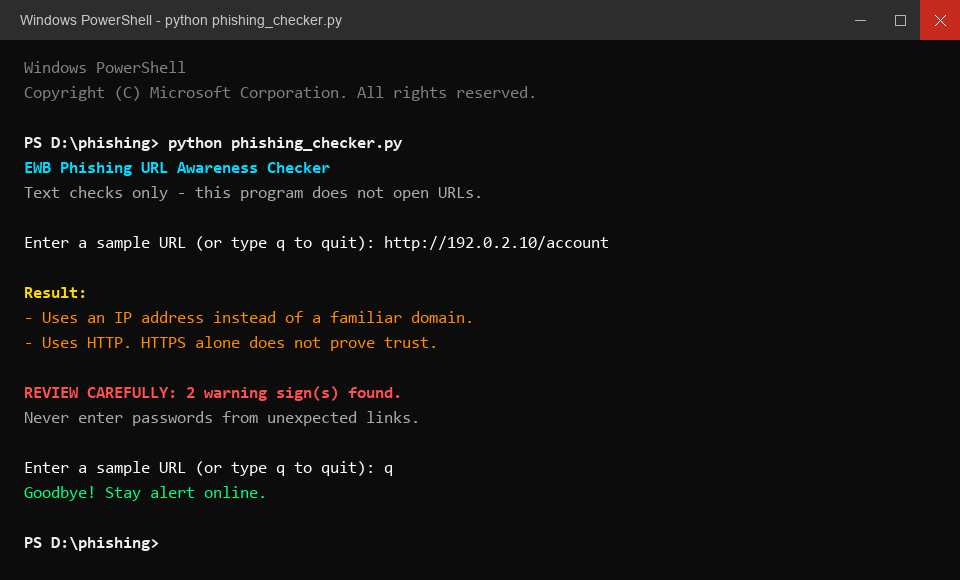
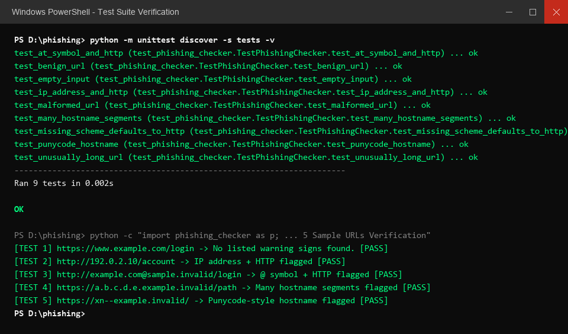

# EWB Phishing URL Awareness Checker

[](https://github.com/mathiaswilliam761-ui/phishing/actions/workflows/ci.yml)

## Overview
Phishing is a social engineering attack where malicious actors deceive victims into revealing sensitive credentials, financial details, or one-time passwords through deceptive links. This tool is a defensive, lightweight Python command-line utility designed to raise cybersecurity awareness by inspecting the plain text of a URL for visible structural warning signs. It operates completely offline and strictly on text without ever visiting or contacting the destination server.

## Features
- **Detects an `@` symbol in the URL**: Flags credentials/userinfo embedded before hostnames used to mislead users regarding destination.
- **Flags unusually long URLs (over 100 characters)**: Highlights potential attempts to obscure the real target domain behind excessive query or path strings.
- **Flags IP-address hostnames**: Identifies numerical host addresses (e.g., `192.0.2.10`) which attackers use to bypass domain name registration.
- **Flags many hostname segments (5 or more)**: Flags excessive subdomain nesting used to mimic legitimate corporate domain hierarchies.
- **Flags punycode-style hostnames (`xn--`)**: Alerts on Internationalized Domain Names (IDNs) commonly exploited in homograph attacks using lookalike characters.
- **Flags the HTTP scheme**: Detects unencrypted plaintext web communication where HTTPS is expected.
- **Interactive Session Loop (Improvement A)**: Allows evaluating multiple URLs in succession without restarting the program, exiting on `q` or `quit`.
- **Warning Count & Summary Notice (Improvement B)**: Distinguishes between informational notices and real risks, printing a clear `REVIEW CAREFULLY: X warning sign(s) found` summary.
- **Resilient Exception Handling (Improvement C)**: Employs safe parsing with `try...except ValueError` to prevent crashes when malformed URLs (e.g., `http://[bad`) are input.
- **Interactive Web Interface & GitHub Pages Deployment**: Includes a client-side web application in `web/index.html` deployable via GitHub Actions.

## Requirements
- Python 3.10 or later
- Standard Python libraries only (`re`, `urllib.parse`, `unittest`)
- No external packages or third-party dependencies required

## How to Run

### Windows
```cmd
python phishing_checker.py
```

### Mac / Linux
```bash
python3 phishing_checker.py
```

### Automated Unit Tests
```bash
python -m unittest discover -s tests -v
```

### Live Interactive Web Demo
Open `web/index.html` in any web browser, or access the live hosted version on GitHub Pages:
```text
https://mathiaswilliam761-ui.github.io/phishing/
```

## Example Output

```text
EWB Phishing URL Awareness Checker
Text checks only - this program does not open URLs.

Enter a sample URL (or type q to quit): http://192.0.2.10/account

Result:
- Uses an IP address instead of a familiar domain.
- Uses HTTP. HTTPS alone does not prove trust.

REVIEW CAREFULLY: 2 warning sign(s) found.
Never enter passwords from unexpected links.

Enter a sample URL (or type q to quit): q
Goodbye! Stay alert online.
```

## Testing

The project was evaluated against the standardized workbook test dataset and additional malformed inputs. Complete testing records are documented in [tests/test_samples.md](tests/test_samples.md).

| # | Input | Expected | Actual | Result |
|---|---|---|---|---|
| 1 | `https://www.example.com/login` | No warning signs | No listed warning signs found. This does NOT prove safety. | PASS |
| 2 | `http://192.0.2.10/account` | IP address + HTTP | Uses an IP address instead of a familiar domain.<br>Uses HTTP. HTTPS alone does not prove trust. | PASS |
| 3 | `http://example.com@sample.invalid/login` | @ symbol + HTTP | Contains an @ symbol; inspect carefully.<br>Uses HTTP. HTTPS alone does not prove trust. | PASS |
| 4 | `https://a.b.c.d.e.example.invalid/path` | Many hostname segments | Contains many hostname segments/subdomains. | PASS |
| 5 | `https://xn--example.invalid/` | Punycode-style hostname | Contains a punycode-style hostname. | PASS |

## Screenshots

### Program Execution


### Automated and Manual Test Evidence


## Improvements
1. **Interactive Session Loop (Option A)**:
   - **What changed**: Replaced single-run execution with an interactive `while True` loop that repeatedly prompts for URLs until the user enters `q`, `quit`, or `exit`.
   - **Why**: Greatly improves user experience by allowing analysts to inspect multiple URLs quickly without restarting the Python interpreter.
   - **How tested**: Tested with consecutive sample URLs followed by pressing `q` to confirm clean exit.

2. **Actionable Alert Summary (Option B)**:
   - **What changed**: Added a helper function `has_warnings()` and a prominent banner `REVIEW CAREFULLY: X warning sign(s) found.`
   - **Why**: Differentiates between normal system messages (such as empty inputs or clean results) and actual warnings, providing a fast visual indicator of risk density.
   - **How tested**: Tested with clean URLs (0 warnings banner suppressed) and multi-flag URLs (e.g. 2 warnings banner triggered).

3. **Crash Protection for Malformed Input (Option C)**:
   - **What changed**: Wrapped `urlparse(candidate)` in a `try...except ValueError` block returning `"This text is not a valid URL format."`
   - **Why**: Prevents Python from crashing when given invalid URL syntax such as malformed IPv6 brackets (`http://[bad`).
   - **How tested**: Verified with `http://[bad` and confirmed program handles the error gracefully without terminating.

4. **Continuous Integration & Automated Deployment via GitHub Actions**:
   - **What changed**: Configured multi-OS, multi-version Python testing workflow (`.github/workflows/ci.yml`) with manual `workflow_dispatch` trigger and automated deployment to GitHub Pages.
   - **Why**: Guarantees cross-platform reliability on Windows and Linux across Python 3.10 through 3.13, allows running checks directly from GitHub without installing Python, and hosts the web interface for demonstration.
   - **How tested**: Validated locally with `unittest` suite passing 9/9 test cases.

## Limitations
This is an educational awareness tool designed strictly to inspect plain URL text. It does **not** visit websites, probe network ports, resolve DNS records, check real-time reputation APIs, or scan pages for malicious payloads. A result showing "No listed warning signs found" does **NOT** prove that a URL is safe; sophisticated attacks often use newly registered legitimate domain names without syntax irregularities.

## Ethical Use
This project is intended strictly for educational and defensive cybersecurity awareness. Use only the safe sample strings provided in this repository or synthetic test cases. Do not harvest credentials, do not attempt to deceive individuals, and never scan or probe external websites without explicit written authorization.

## Author
Mathias William (@mathiaswilliam761-ui), Cybersecurity Mini Project, EWB Courses
